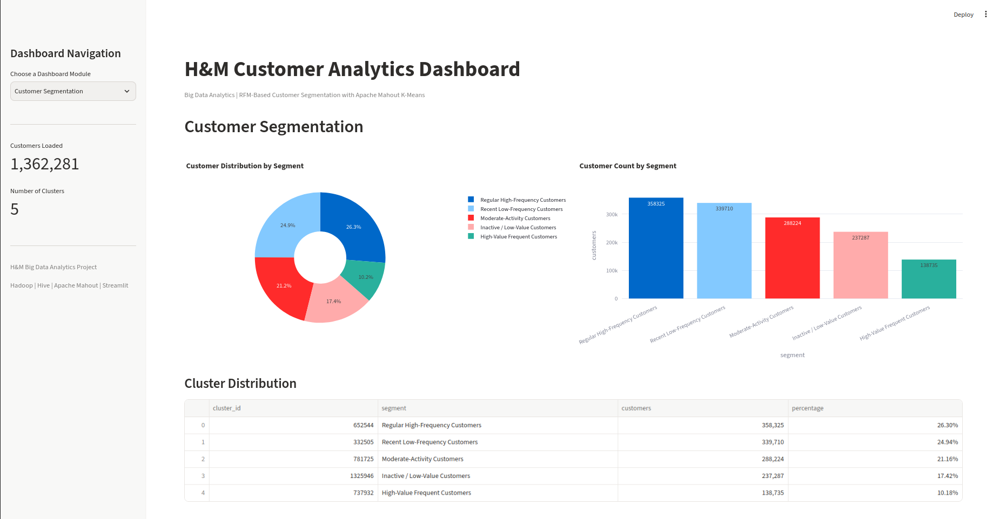
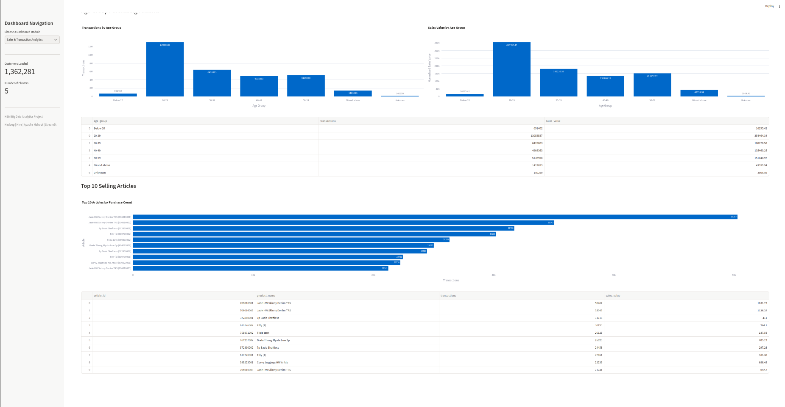

# H&M Customer Analytics and Customer Segmentation

A Big Data Analytics project that analyzes the H&M Personalized Fashion Recommendations dataset using Hadoop, HDFS, Apache Hive, and Apache Mahout. The project performs large-scale customer analytics, RFM-based customer segmentation using K-Means clustering, and interactive visualization through a Streamlit dashboard.

## Project Overview

The project processes H&M transaction, customer, and article data to discover purchasing patterns, understand customer behavior, and identify distinct customer segments.

It combines distributed data processing with customer-level analytical techniques to generate business insights from a large retail dataset.

## Objectives

- Process large-scale retail transaction data using Hadoop and HDFS.
- Perform structured analytics using Apache Hive.
- Analyze customer purchasing behavior using Recency, Frequency, and Monetary (RFM) metrics.
- Apply K-Means clustering using Apache Mahout.
- Map clustering results back to customer-level records.
- Present analytical findings through an interactive Streamlit dashboard.

## Dataset

**Dataset:** H&M Personalized Fashion Recommendations

**Source:** Kaggle  
https://www.kaggle.com/competitions/h-and-m-personalized-fashion-recommendations/data

The dataset contains three primary files:

| File | Description |
|---|---|
| transactions_train.csv | Customer purchase transactions |
| customers.csv | Customer demographic and profile information |
| articles.csv | Product and article information |

Approximate dataset characteristics:

- Transactions: 31.8 million
- Customers: 1.37 million
- Articles: 105,542

The original Kaggle dataset is not included in this repository. Download it separately from Kaggle and place it in the appropriate project data location.

## Technology Stack

| Technology | Purpose |
|---|---|
| Apache Hadoop 3.3.6 | Distributed data processing |
| HDFS | Distributed file storage |
| Apache Hive 4.1.0 | SQL-based analytics |
| Apache Mahout 0.13.0 | K-Means clustering |
| Java 17 | Mahout cluster extraction utility |
| Python | Data preprocessing and mapping |
| Pandas | Data manipulation |
| Streamlit | Interactive dashboard |
| Plotly | Data visualization |

## Project Architecture

```text
             H&M Kaggle Dataset
                      |
          Transactions / Customers
                / Articles
                      |
                      v
                Hadoop HDFS
                      |
                      v
                Apache Hive
                      |
          +-----------+-----------+
          |                       |
          v                       v
   Transaction Analytics     Customer RFM
          |                       |
          |                       v
          |                RFM Preprocessing
          |                       |
          |                       v
          |              Feature Scaling
          |                       |
          |                       v
          |              Apache Mahout
          |                K-Means
          |                       |
          |                       v
          |              Customer Mapping
          |                       |
          +-----------+-----------+
                      |
                      v
              Analytical CSV Files
                      |
                      v
             Streamlit Dashboard
                      |
                      v
              Business Insights
```

## Implementation

### 1. Hadoop and HDFS

The H&M dataset was stored in HDFS to support large-scale data processing.

HDFS was used to manage the source dataset and provide distributed storage for subsequent analytical operations.

### 2. Apache Hive Analytics

A Hive database named `hm_customer_analytics` was created.

The following tables were used:

- `transactions`
- `customers`
- `articles`
- `customer_rfm`

The analysis included:

- Monthly transaction trends
- Sales channel distribution
- Product category analysis
- Customer age-group analysis
- Top-selling articles

The transaction analytics covered approximately 31.8 million transactions.

### 3. RFM Feature Engineering

Customer purchasing behavior was represented using three RFM metrics:

| Metric | Description |
|---|---|
| Recency | Days since the customer's latest purchase |
| Frequency | Number of transactions made by the customer |
| Monetary | Sum of the customer's transaction price values |

The reference date used for recency calculation was September 22, 2020.

Feature preprocessing included:

- RFM aggregation at customer level
- Log transformation of Frequency and Monetary
- Min-Max scaling
- Preparation of the clustering input

### 4. Customer Segmentation with Apache Mahout

Apache Mahout K-Means was used to group customers based on their scaled RFM features.

The selected number of clusters was:

**K = 5**

The clustering process was executed using Hadoop MapReduce.

A Java utility (`ExtractClusters.java`) and Python mapping script were used to associate the Mahout clustering results with customer-level RFM records.

### 5. Customer Mapping and Validation

The final customer-cluster mapping was validated against the customer RFM records.

| Metric | Result |
|---|---:|
| Total customer records mapped | 1,362,281 |
| Unmatched records | 0 |
| Number of clusters | 5 |

### 6. Streamlit Dashboard

An interactive dashboard was developed to present the results.

The dashboard contains six sections:

1. **Dataset Overview** – Dataset summary and key metrics.
2. **Customer Segmentation** – Customer cluster distribution and visualization.
3. **RFM Analysis** – Recency, Frequency, and Monetary analysis.
4. **Customer Explorer** – Explore customer-level records.
5. **Business Insights** – Interpret customer behavior and segment characteristics.
6. **Sales & Transaction Analytics** – Monthly trends, channels, product categories, age groups, and top articles.

## Key Results

### Transaction Analytics

- Approximately 31.8 million transactions were analyzed.
- Channel 2 contributed approximately 70.40% of transactions.
- Channel 1 contributed approximately 29.60%.
- Customers aged 20–29 represented the highest transaction count.
- Trousers were the leading product type, with 4,217,017 transactions.
- Article `0706016001` was the top-selling article, with 50,287 transactions.

### Customer Segmentation

The K-Means implementation generated five customer clusters.

The cluster characteristics were interpreted using their RFM profiles:

| Cluster ID | Customer characteristics |
|---|---|
| 737932 | Very recent purchases, high frequency, and high monetary value |
| 1325946 | Inactive or less recent customers with low frequency and monetary value |
| 332505 | Recent customers with low frequency and monetary value |
| 652544 | Recent customers with medium-to-high frequency and moderate monetary value |
| 781725 | Customers with moderate recency, lower frequency, and lower spending |

Cluster IDs are Mahout-generated identifiers, not rankings.

## Repository Structure

```text
hm-customer-analytics/
│
├── dashboard/
│   ├── app.py
│   └── data/
│       ├── age_groups.csv
│       ├── channel_distribution.csv
│       ├── monthly_trends.csv
│       ├── product_categories.csv
│       └── top_articles.csv
│
├── data/
│   ├── customer_clusters_final.csv.gz
│   └── customer_rfm.tsv.gz
│
├── ExtractClusters.java
├── create_customer_mapping.py
├── preprocess_rfm.py
├── rfm_dictionary
└── .gitignore
```

## Running the Dashboard

### Prerequisites

- Python 3.10 or later
- pip
- Git

### 1. Clone the repository

```bash
git clone https://github.com/vishalkoripala/hm-customer-analytics.git
cd hm-customer-analytics
```

### 2. Create a virtual environment

```bash
python3 -m venv venv
source venv/bin/activate
```

### 3. Install dashboard dependencies

```bash
pip install streamlit pandas plotly
```

### 4. Launch the dashboard

```bash
cd dashboard
streamlit run app.py
```

The dashboard will be available at:

```text
http://localhost:8501
```

The dashboard uses the analytical CSV files included in `dashboard/data/`.

## Limitations

- The original H&M dataset must be downloaded separately from Kaggle.
- The monetary metric uses the normalized price values in the source dataset; it should not be interpreted as Indian Rupees.
- The project analyzes historical transaction data rather than real-time transaction streams.
- The dashboard uses a sample of up to 30,000 records for the RFM scatter visualization to improve rendering performance. Other customer-level metrics use the full available data.

## Future Enhancements

- Integrate recommendation algorithms for personalized product suggestions.
- Introduce customer lifetime value estimation.
- Explore alternative clustering algorithms and compare segmentation quality.
- Implement incremental processing for newly arriving transactions.
- Extend the dashboard with predictive analytics.
- Deploy the dashboard to a cloud platform.

## Author

**Vishal Koripala**

B.Tech – Computer Science and Engineering (AI & ML)

Anil Neerukonda Institute of Technology & Sciences

## License and Dataset Attribution

This repository contains project source code and derived analytical outputs.

The original dataset is provided by H&M through the Kaggle competition. Users should obtain the dataset directly from Kaggle and follow its competition rules and applicable terms.

## Dashboard Screenshots

### Dataset Overview


### Customer Segmentation


### RFM Analysis


### Sales and Transaction Analytics


